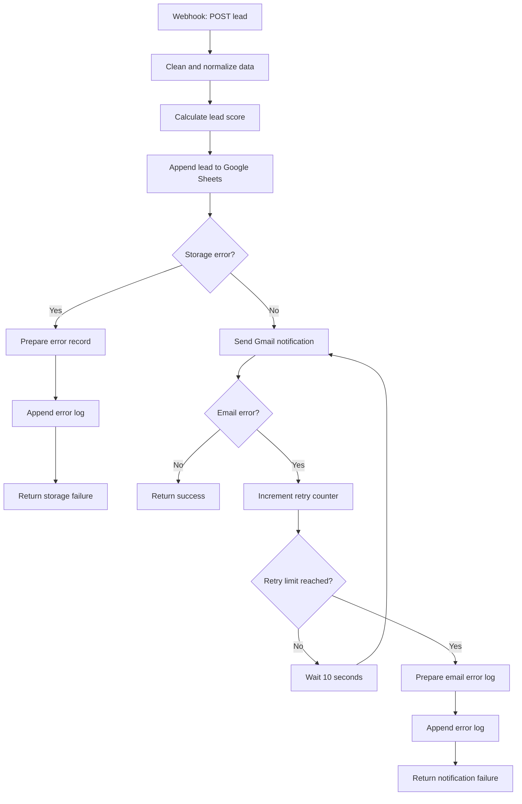
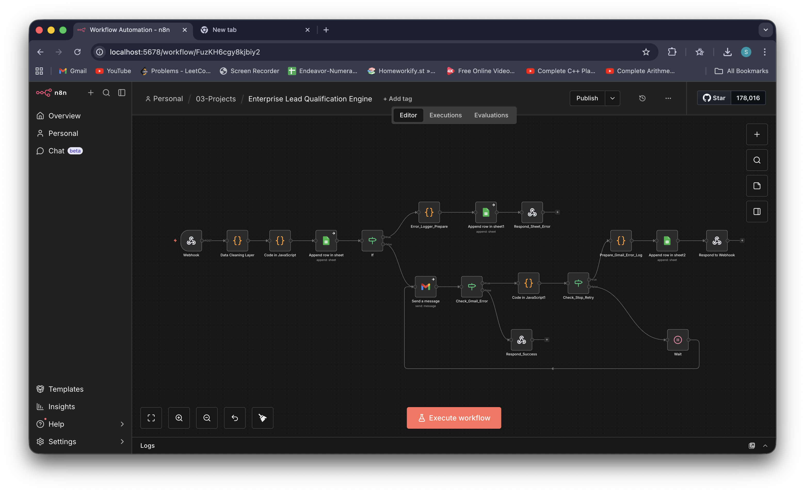

<div align="center">

# ⚡ Enterprise Lead Qualification Engine

**An n8n workflow concept for automating lead intake, scoring, routing, and operational notifications.**

<p>
  
  
  
  
</p>

[Overview](#-overview) · [Workflow](#-workflow-architecture) · [Scoring](#-lead-scoring) · [Setup](#-setup) · [Security](#-security--privacy) · [Roadmap](#-possible-improvements)

</div>

---

## 🎯 Overview

The **Enterprise Lead Qualification Engine** demonstrates how a lead-processing pipeline can be orchestrated in [n8n](https://n8n.io/).

It is designed to accept lead details through a webhook, normalize incoming data, calculate a qualification score, classify the lead, and connect the result to Google Sheets and Gmail.

> **Repository status:** The uploaded workflow file is preserved as a review artifact, but it is not valid JSON in its supplied form and cannot currently be imported into n8n. Re-export the workflow from n8n as JSON before using it. See [Workflow export status](#-workflow-export-status).

## ✨ What it demonstrates

- **Webhook intake** — receive lead submissions through an HTTP `POST` endpoint.
- **Data normalization** — trim names, normalize email and city values, and convert budget to a number.
- **Rule-based qualification** — calculate a score from budget, city, and lead source.
- **Priority classification** — categorize leads as High, Medium, or Low.
- **Google Sheets integration** — append lead and error information to spreadsheet tabs.
- **Email notification** — send a Gmail notification for a processed lead.
- **Failure handling concept** — branch on errors, prepare error records, and retry email delivery with a wait step.

## 🧭 Workflow architecture



## 🧮 Lead scoring

The workflow's JavaScript scoring rules assign points as follows:

| Signal | Condition | Points |
|---|---|---:|
| Budget | Greater than 50,000 | +50 |
| Budget | Greater than 30,000 and up to 50,000 | +30 |
| Budget | 30,000 or less | +10 |
| City | Bangalore | +30 |
| City | Mumbai | +20 |
| City | Any other city | +5 |
| Source | `website` | +20 |

Priority is then assigned using the total score:

| Total score | Priority |
|---:|---|
| 80 or more | High |
| 50–79 | Medium |
| Below 50 | Low |

These are example business rules in the supplied workflow, not universal qualification criteria. Adjust the thresholds to match the business.

## 🖼️ Workflow preview



## 🧰 Technology

| Technology | Purpose |
|---|---|
| [n8n](https://n8n.io/) | Workflow orchestration |
| JavaScript | Data cleaning, scoring, and retry logic |
| Webhooks | Lead intake endpoint |
| Google Sheets | Lead and error-log storage |
| Gmail | Lead notification |
| Postman | Webhook/API testing |

## 📁 Repository structure

```text
n8n-project/
├── README.md
├── .gitignore
├── SECURITY-REVIEW.md
├── screenshots/
│   └── workflow-overview.png
└── workflow/
    └── Enterprise Lead Qualification Engine.export-review.txt
```

## 🚀 Setup

### 1. Prepare n8n

Run an n8n instance using the [official installation documentation](https://docs.n8n.io/hosting/).

### 2. Re-export the workflow

The workflow artifact supplied in this repository is malformed tab-delimited text despite having originally been named `.json`. It is retained as a `.txt` review artifact so it is not mistaken for a valid import file.

Open the original workflow in your n8n instance and export it using **Download** / **Export** as JSON. Save the valid export under:

```text
workflow/Enterprise Lead Qualification Engine.json
```

Validate the exported file before committing:

```bash
python -m json.tool "workflow/Enterprise Lead Qualification Engine.json" > /dev/null
```

### 3. Configure integrations

In n8n, configure credentials using its credential manager:

- Google Sheets OAuth2 credentials and access to the target spreadsheet.
- Gmail OAuth2 credentials and permission to send notifications.

The workflow artifact contains placeholder spreadsheet identifiers and a placeholder recipient address. Replace them inside n8n with values appropriate to your environment. Do not commit real credentials, OAuth tokens, private keys, or production personal data.

### 4. Configure Google Sheets

Create a spreadsheet with tabs and columns that match the workflow's mappings.

**Lead tab** (as represented by the workflow):

`name`, `email`, `budget`, `city`, `score`, `priority`, `created_at`

**Error log tab** (as represented by the workflow):

`error_message`, `failed_step`, `payload_snapshot`, `timestamp`

Review the privacy guidance below before enabling payload snapshots.

### 5. Test the webhook

After importing and configuring a valid workflow, use the webhook's test URL in Postman. The workflow expects a JSON body similar to:

```json
{
  "name": "Alex Morgan",
  "email": "alex@example.com",
  "city": "Bangalore",
  "budget": 60000,
  "source": "website"
}
```

Use fictional test data. Do not test with real customer information in a public demo.

The webhook path in the supplied artifact is `lead-qualification-demo`. n8n generates the full test and production URLs for your instance.

## 🔐 Security & privacy

Security review of the supplied archive:

- No obvious live API keys, passwords, OAuth access tokens, or private-key material were found in the inspected workflow and README.
- Google Sheets document IDs, sheet names, tab names, and recipient email are placeholders.
- n8n credentials should be stored in n8n's credential manager, not embedded in exported workflow JSON or source files.
- The workflow's `payload_snapshot` error fields serialize the input payload. This can put names, email addresses, budgets, and other personal data into an error spreadsheet. Prefer logging a minimal, redacted diagnostic record instead.
- Protect the webhook with authentication or another appropriate access-control mechanism before exposing it publicly. Consider rate limits and input validation.
- Restrict access to the Google spreadsheet and n8n instance. Apply retention limits to lead and error data.
- Review error responses before production use; avoid returning internal error details to external callers.

See [`SECURITY-REVIEW.md`](SECURITY-REVIEW.md) for the detailed audit notes.

## 🛣️ Possible improvements

- Add schema validation and reject malformed or incomplete lead submissions.
- Make scoring thresholds configurable rather than embedding them in JavaScript.
- Add deduplication using a stable lead identifier or normalized email.
- Redact personal data from error logs and define retention policies.
- Add authenticated webhook access, rate limiting, and abuse monitoring.
- Add automated workflow tests for scoring boundaries and failure paths.
- Add a dead-letter path and operational alerts for repeated integration failures.

## 📚 References

- [n8n documentation](https://docs.n8n.io/)
- [n8n Webhook node](https://docs.n8n.io/integrations/builtin/core-nodes/n8n-nodes-base.webhook/)
- [n8n Google Sheets node](https://docs.n8n.io/integrations/builtin/app-nodes/n8n-nodes-base.googlesheets/)
- [n8n Gmail node](https://docs.n8n.io/integrations/builtin/app-nodes/n8n-nodes-base.gmail/)

---

<div align="center">

**Built to explore practical workflow automation with n8n and JavaScript.**

</div>
