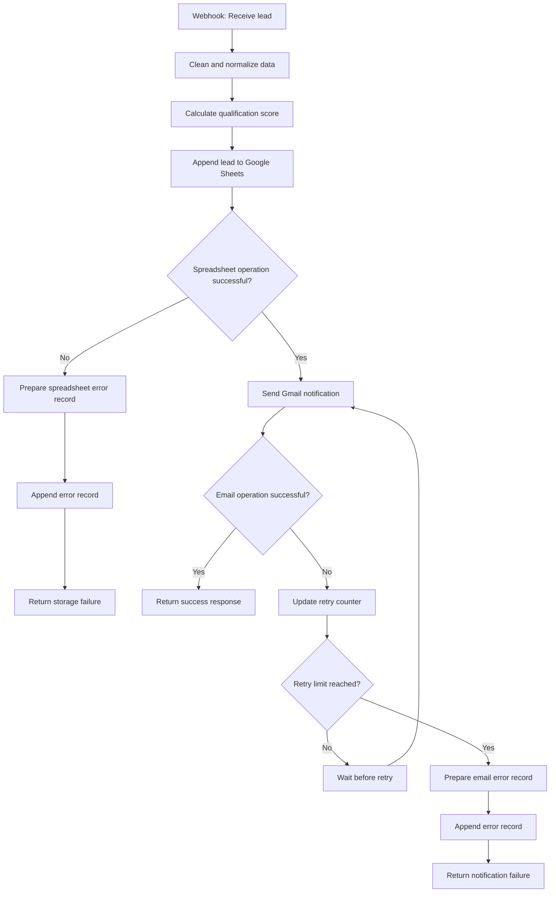

<div align="center">

# ⚡ Enterprise Lead Qualification Engine

### Automated lead intake, scoring, tracking, and notifications with n8n

<p>
  <a href="https://n8n.io/">
    
  </a>
  
  
  
</p>

[Overview](#overview) · [Features](#features) · [Architecture](#workflow-architecture) · [Scoring](#lead-scoring) · [Preview](#workflow-preview) · [Setup](#getting-started) · [Improvements](#possible-improvements)

</div>

---

## Overview

The **Enterprise Lead Qualification Engine** is an n8n automation project that demonstrates an end-to-end lead processing workflow. It receives lead submissions through a webhook, standardizes the incoming data, calculates a rule-based qualification score, assigns a priority, stores the lead in Google Sheets, and sends an email notification through Gmail.

The workflow also includes error branches for spreadsheet and email operations, with a retry path for email delivery.

## Features

- **Webhook-based intake:** Accept lead submissions through an HTTP `POST` endpoint.
- **Data normalization:** Standardize names, email addresses, and city values; convert budget values to numbers.
- **Rule-based lead scoring:** Calculate a score using budget, city, and lead source.
- **Priority assignment:** Classify leads as High, Medium, or Low.
- **Google Sheets integration:** Store qualified lead details and workflow error records.
- **Gmail notifications:** Send an email notification after lead processing.
- **Error handling:** Route spreadsheet and email failures through dedicated error-handling branches.
- **Retry handling:** Wait and retry email delivery before recording a final failure.

## Workflow Architecture



## Lead Scoring

The workflow calculates a score using three lead attributes: budget, city, and source.

| Attribute | Condition | Points |
|---|---|---:|
| Budget | Greater than 50,000 | +50 |
| Budget | Greater than 30,000 and up to 50,000 | +30 |
| Budget | 30,000 or less | +10 |
| City | Bangalore | +30 |
| City | Mumbai | +20 |
| City | Any other city | +5 |
| Source | `website` | +20 |

The total score determines the lead priority:

| Total score | Priority |
|---:|---|
| 80 or more | High |
| 50–79 | Medium |
| Below 50 | Low |

These are configurable example rules. Update the scoring logic to reflect the qualification criteria of the business using the workflow.

## Workflow Preview

<div align="center">
  
</div>

## Technology Stack

| Technology | Role |
|---|---|
| [n8n](https://n8n.io/) | Workflow automation and orchestration |
| JavaScript | Data normalization, scoring, and retry logic |
| Webhook | Lead submission endpoint |
| [Google Sheets](https://www.google.com/sheets/about/) | Lead and error-record storage |
| [Gmail](https://www.google.com/gmail/about/) | Email notifications |
| [Postman](https://www.postman.com/) | Webhook testing |

## Repository Structure

```text
n8n-enterprise-lead-qualification/
├── README.md
├── .gitignore
├── SECURITY-REVIEW.md
├── screenshots/
│   └── workflow-overview.png
└── workflow/
    └── Enterprise Lead Qualification Engine.export-review.txt
```

## Getting Started

### Prerequisites

- An available [n8n instance](https://docs.n8n.io/hosting/)
- Google account access for Google Sheets
- Gmail account access for sending notifications
- [Postman](https://www.postman.com/) or another HTTP client for testing

### 1. Set up n8n

Start or access an n8n instance. For installation and hosting options, see the [official n8n hosting documentation](https://docs.n8n.io/hosting/).

### 2. Prepare the workflow

The file in `workflow/` is a text-formatted workflow reference. It is included for inspection and is not a native n8n JSON export that can be imported directly.

To run the automation, open the workflow in your n8n instance and export or recreate it as a valid n8n workflow JSON file. Save the usable export in the `workflow/` directory.

### 3. Configure integrations

Create and select the required credentials in n8n:

- **Google Sheets:** Configure Google Sheets access and select the destination spreadsheet and worksheet.
- **Gmail:** Configure Gmail access for sending notification emails.

Replace the sample spreadsheet identifiers, worksheet values, and recipient address with values for your environment. Keep authentication details in n8n credentials.

### 4. Prepare the Google Sheet

Create a spreadsheet with a lead worksheet containing these columns:

`name`, `email`, `budget`, `city`, `score`, `priority`, `created_at`

Create an error-log worksheet with the columns used by the error-handling nodes:

`error_message`, `failed_step`, `payload_snapshot`, `timestamp`

### 5. Test the webhook

After the workflow is configured, use the webhook test URL generated by n8n. Send a `POST` request with a JSON body such as:

```json
{
  "name": "Alex Morgan",
  "email": "alex@example.com",
  "city": "Bangalore",
  "budget": 60000,
  "source": "website"
}
```

The webhook path configured in the workflow reference is `lead-qualification-demo`. The complete test and production URLs are generated by your n8n instance.

## Possible Improvements

- Add input schema validation and clear responses for invalid submissions.
- Move scoring thresholds into configurable workflow variables.
- Add duplicate-lead detection using a stable identifier or normalized email address.
- Add webhook authentication and request rate limiting.
- Define data-retention rules for lead and error records.
- Add automated tests for scoring thresholds and error paths.
- Add operational alerts for repeated integration failures.

## References

- [n8n documentation](https://docs.n8n.io/)
- [n8n hosting and installation](https://docs.n8n.io/hosting/)
- [n8n Webhook node](https://docs.n8n.io/integrations/builtin/core-nodes/n8n-nodes-base.webhook/)
- [n8n Google Sheets node](https://docs.n8n.io/integrations/builtin/app-nodes/n8n-nodes-base.googlesheets/)
- [n8n Gmail node](https://docs.n8n.io/integrations/builtin/app-nodes/n8n-nodes-base.gmail/)

---

<div align="center">

**Workflow automation · Lead qualification · Integration orchestration**

</div>
